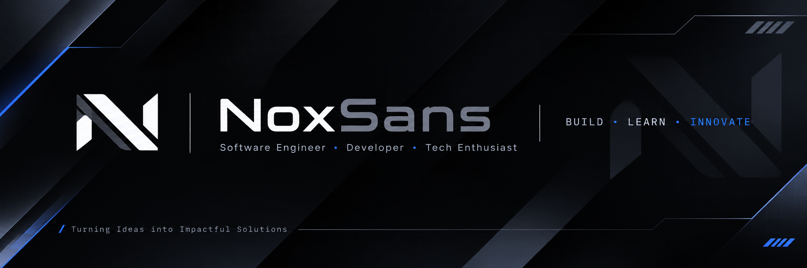

  
  <h1>Muhammad Ihsan Hanafi</h1>
  <h3>NoxSans · Software Developer</h3>  

    <em>Building practical digital solutions through curiosity, engineering, and continuous learning.</em>
  
  

    
    
  

About
I'm Muhammad Ihsan Hanafi, also known as NoxSans — an Informatics student at Universitas Gunadarma with an interest in software engineering and practical technology.

I enjoy exploring how software works across different layers, from user-facing interfaces to backend services and database systems. I learn by building projects, experimenting with tools, and improving solutions through iteration.

My current interests include web and backend development, database engineering, mobile applications, cybersecurity, and robotics.
- Education: B.Sc. in Informatics — Universitas Gunadarma
- Community / Experience: Laboratory Assistant at LePKom
- GitHub: @NoxSans24
- Current focus: Go, backend development, web technologies, and DBMS
Areas of Interest
Domain	Focus
Software Engineering	Designing and building maintainable applications
Web Development	Responsive interfaces and web application architecture
Backend Development	APIs, application logic, and server-side systems
Database Engineering	Relational databases, data modeling, and SQL
Mobile Development	Cross-platform application development
Cybersecurity	Learning security concepts and safer development practices
Robotics & Networking	Exploring hardware, automation, and network fundamentals

Technical Skills
The technologies below represent tools I have used, explored, or worked with in learning and project contexts. My depth of experience varies by technology.
Programming Languages

  
  
  
  
  
  
  
  
  
  
  

Frameworks, Libraries & Runtime

  
  
  
  
  
  

Databases

  
  
  
  

Data & Scientific Computing

  
  
  
  
  
  

Tools, Design & Infrastructure

  
  
  
  
  
  
  
  

Hardware & Networking

  
  

Experience
Laboratory Assistant — LePKom
2025 – Present

Contributing to the learning environment at LePKom while continuing to develop technical and communication skills.

Areas of contribution include:
- Supporting practical learning activities and lab sessions.
- Helping students understand programming and computing concepts.
- Strengthening problem-solving, collaboration, and technical communication.
Selected Projects
I use personal and collaborative projects to explore ideas, apply concepts, and improve my engineering workflow.
Project	Description	Repository
Anantalia Trans	Transportation service platform with public-facing and administrative workflows.	View repository
AIStudy	Collaborative learning application exploring document-based study assistance.	Explore GitHub
TaskBell	Task management application focused on organizing everyday activities.	Explore GitHub

Project descriptions are concise summaries; visit the repositories for implementation details, current status, and technologies used.

Currently Learning
- Go (Golang): Improving language fundamentals and backend development skills.
- Web Engineering: Building maintainable and responsive web applications.
- Database Management: Practicing relational data modeling, SQL, and DBMS concepts.
- Backend Development: Exploring API design, application architecture, and server-side development.
- Cybersecurity: Developing a stronger foundation in secure software practices.
GitHub Activity

  
  
   
  

Connect
I'm open to learning opportunities, collaboration, and conversations about software development and technology.

  
  
  
  
  
  

  Designed and maintained by <strong>NoxSans</strong> · Build. Learn. Innovate.

